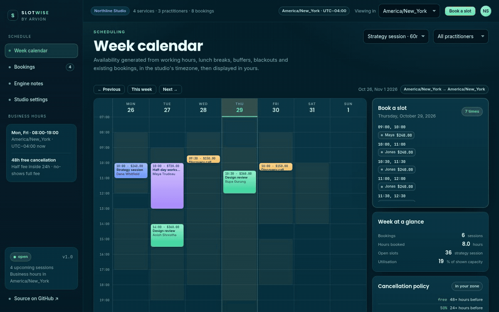
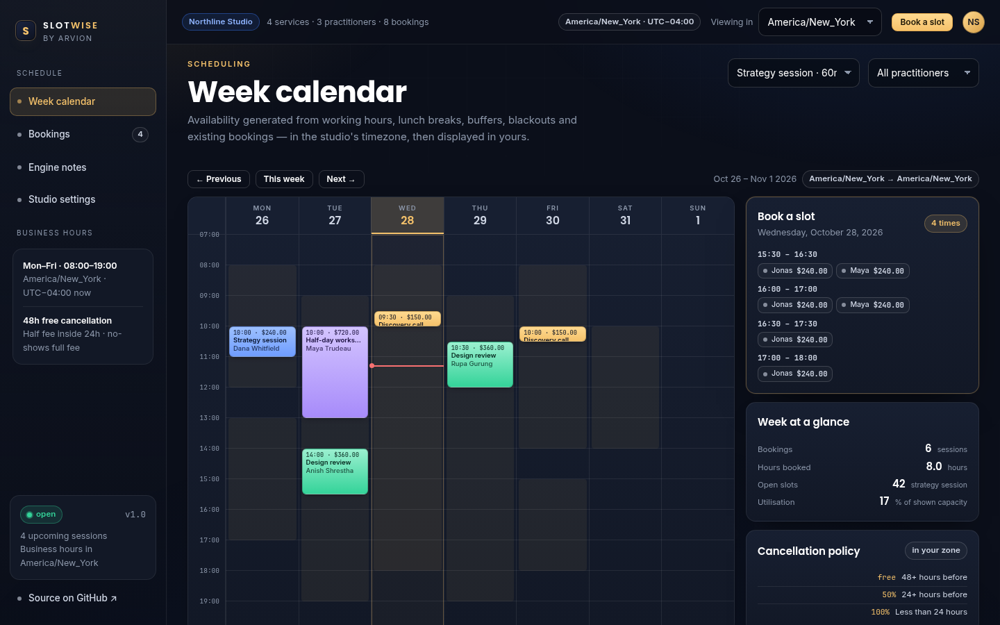

<div align="center">

</div>

<sub>Recorded from the live demo, <a href="docs/demo.mp4">MP4</a> · <a href="docs/screenshot.png">static frame</a></sub>

# Slotwise

A booking engine that gets timezones right. It generates availability from staff working hours, lunch breaks, service buffers, blackout dates and existing bookings, then displays the result in whatever zone the viewer is in. No dependencies, no build step, no server.

[**Open the live demo**](https://arvion-technology.github.io/labs/demos/slotwise/) · [MIT](LICENSE)

---

The demo studio is four services and three practitioners on America/New_York time, with a seeded week of bookings and a pair of blackout blocks. Pick a service, click a day, choose a time, and the booking becomes an absolute instant; change the "Viewing in" selector and every slot, booking and label re-renders for that zone without touching the underlying data. Cancel a booking and the fee is quoted from the policy tier against the clock.

## What it does

- **Week calendar**: a seven-day grid with working-hour shading, service-coloured bookings, a live "now" line and day selection.
- **Availability engine**: weekly rota windows, lunch breaks, per-service prep and reset buffers, slot intervals, minimum notice, per-staff and studio-wide blackouts.
- **Viewer timezone**: convert the studio's instants into New York, London, Kathmandu, Tokyo, Sydney or UTC; slots that cross the viewer's date land in the right column.
- **Booking flow**: pick a slot, choose the practitioner, enter customer details, then get a confirmation with a downloadable `.ics` file.
- **Bookings list**: upcoming and past sessions, per-booking ICS export, cancellation quotes and a whole-calendar export.
- **Engine notes**: the live offset, the 23-hour and 25-hour DST days, an overnight-window example and the exact conversion steps.

## Screenshots

| Week calendar | Bookings |
| --- | --- |
|  |  |

## Architecture

```text
demo/index.html + app.js        calendar, slot picker, booking flow, exports
   │  imports
   ├── src/timezone.js          IANA parts/offsets, wall-time → 0/1/2 instants
   ├── src/availability.js      windows + buffers + blackouts → slots
   ├── src/ics.js               RFC 5545 export, folding, escaping, parser
   ├── src/policy.js            cancellation tiers and reschedule window
   └── src/sample.js            services, rota, seeded bookings, blackouts
test/*.test.js                  37 node:test cases
```

The UI never does timezone arithmetic itself. It calls the same `generateRangeAvailability()` and `buildICS()` functions the tests call, and it renders whatever instants come back.

## Quickstart

```bash
git clone https://github.com/arvion-technology/slotwise.git
cd slotwise
npm test          # 37 tests, no dependencies, Node 20+
npm run demo      # http://localhost:4173
```

There is nothing to install. `package.json` exists so `npm test` and CI have a standard entry point.

## How it works

**Wall time and instants are different things.** A booking is an absolute instant (milliseconds since the epoch). Working hours are wall-clock windows in a zone. The conversion goes through `Intl.DateTimeFormat` with an explicit IANA zone, never `new Date(year, month, day)`, because the `Date` constructor uses the *browser's* zone and silently accepts impossible times.

The conversion has three cases, and the code represents all three rather than picking one:

```js
zonedTimeToInstants({ year: 2026, month: 3, day: 8, hour: 2, minute: 30 }, "America/New_York");
// [], 02:30 does not exist; the clock jumps from 02:00 to 03:00

zonedTimeToInstants({ year: 2026, month: 11, day: 1, hour: 1, minute: 30 }, "America/New_York");
// [05:30Z, 06:30Z], 01:30 happens twice; "earlier" is the default

zonedDayLength("2026-03-08", "America/New_York"); // 23 hours
zonedDayLength("2026-11-01", "America/New_York"); // 25 hours
```

A spring-forward start is skipped by the generator. A fall-back start resolves to the earlier instant. A naive booking engine invents the missing 02:30 and charges someone for an appointment that cannot be shown on a clock.

**Slot generation is one ordered pipeline.** For each service and staff member on a date:

```text
weekly windows → wall times → instants (skip gaps)
  → step by slotIntervalMinutes, drop a slot whose duration does not fit the window
  → expand by bufferBeforeMinutes / bufferAfterMinutes
  → reject if the expanded interval overlaps a booking or blackout
  → reject if the start is inside minNoticeMinutes from now
```

Buffers may extend past the edge of the working window, prepping before the first meeting does not require the studio to open earlier, but they always count when checking conflicts. Overnight windows (`22:00`, `06:00`) keep their starting date: the service date is Monday while several slots fall on Tuesday in the wall clock. The tests pin that case, along with a 23-hour day and a repeated hour.

**Display is a projection, not a second data model.** Slots are generated on the studio's calendar dates. To draw the viewer's week, each slot's absolute start is converted to the viewer's zone and bucketed by the viewer's date. Change the selector to Asia/Kathmandu and a 09:00 New York session appears at 18:45 the same day; a late New York session can move to the next Kathmandu day. The booking keeps its instant, which is why the `.ics` file is unambiguous.

**ICS is written for other calendars, not for us.** Every line ends CRLF; long lines are folded at 75 UTF-8 octets with a leading space on continuations; commas, semicolons, backslashes and newlines are escaped; times are written in UTC with `DTSTART:20261102T190000Z`. The repository also ships a small parser because a serialiser with no reader is untested by construction, the tests export a booking, parse it back and compare the instants.

**Cancellation tiers select the best applicable window, not the first one.** A booking 72 hours out must match the free tier even though the 24-hour tier also "matches". `cancellationQuote()` sorts tiers by threshold and picks the largest one the booking still clears; the fee is basis points of the price rounded once in integer minor units, so the refund plus fee always equals the price.

## Tests

```bash
npm test
```

37 tests on `node:test`:

- `test/timezone.test.js`: DST offsets, spring gaps, fall overlaps and disambiguation, 23/25-hour days, zone-correct date keys, labels, calendar arithmetic and leap years.
- `test/availability.test.js`: window and lunch-break handling, slot fitting, buffers, blackouts, minimum notice, overnight windows, both DST transitions, multi-staff flattening, range generation and conflict semantics.
- `test/ics.test.js`: envelope, CRLF, UTC formatting, escaping, 75-octet folding, a full export/parse round trip and cancelled status.
- `test/policy.test.js`: tier boundaries, half and full fees, integer rounding, past bookings, custom policies and reschedule windows.
- `test/sample.test.js`: the seeded studio is internally consistent and generated slots never collide with its bookings or blackouts.

The demo also has a static check:

```bash
node scripts/serve-check.mjs
```

## Limitations

- The demo runs one studio with one business timezone. The engine takes a zone per staff member, so mixed-zone teams are representable, but the UI's business calendar is single-zone.
- There is no authentication, payment capture, email delivery or database. A booking lives in `localStorage` and the `.ics` file is the durable artefact.
- Cancellation and reschedule quotes are calculations, not refunds. Nothing is charged or returned by the demo, and there is no no-show workflow beyond the policy wording.
- Recurring bookings, waitlists, round-robin assignment and calendar sync are out of scope. The README would be lying if it implied otherwise.
- The `.ics` reader is deliberately minimal: no VTIMEZONE, recurrence rules or arbitrary parameters. It exists to verify this repository's own output.
- The sample studio, practitioners and customers are fictional. Every date is generated relative to the current week so the demo still has a live calendar next month.

## Project layout

```text
slotwise/
├── demo/
│   ├── index.html        week calendar, bookings, engine notes, settings
│   ├── app.js            rendering, booking flow, exports
│   ├── arvion.css        shared Arvion design system
│   ├── styles.css        calendar, slot picker, booking blocks
│   └── arvion.js         charts, tables, formatting, storage helpers
├── src/
│   ├── timezone.js       IANA wall-time conversions
│   ├── availability.js   slot generation and conflict checks
│   ├── ics.js            calendar export and a small parser
│   ├── policy.js         cancellation and reschedule quotes
│   └── sample.js         the seeded studio
├── test/                 37 node:test cases
├── scripts/              serve, screenshot, static check
└── .github/workflows/    tests on Node 20 and 22
```

## Credits

Built by [Arvion Technologies](https://arviontech.net) in Kathmandu as part of our open-source [Labs](https://github.com/arvion-technology/labs) series. MIT licensed.
